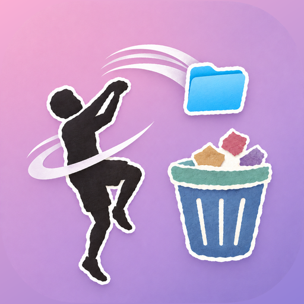

# TrashFree



An open-source macOS disk space analyzer inspired by [DaisyDisk](https://daisydiskapp.com/). Find what's filling your disk, drag it to the collector, and move it to the Trash in one click.

> ⚠️ **Note**: This is an independent open-source project. It is not affiliated with, endorsed by, or connected to Software Ambience Corp. or the commercial DaisyDisk application.

## Features

- 🗺️ **Interactive Sunburst Map** - Visualize disk usage with a beautiful radial treemap
- 📁 **Fast Scanning** - Scan a whole disk or any folder, with a live progress bar
- 🎯 **Drill Down Navigation** - Click a segment to zoom in with an animation; click the center to zoom out
- 🗑 **Collector** - Drag segments onto the collector, then move them all to the Trash at once
- ☁️ **Cloud Storage Support** - Scan Dropbox, Google Drive, OneDrive (coming soon)

## Download

Download [TrashFree.zip](https://github.com/antedotee/trashfree/releases/latest/download/TrashFree.zip)
from the [latest release](https://github.com/antedotee/trashfree/releases/latest), unzip it,
and move TrashFree to Applications. Website: https://antedotee.github.io/trashfree/

The app is not notarized by Apple yet, so macOS blocks the first launch. Click **Done** in
the "TrashFree Not Opened" dialog, then open System Settings > Privacy & Security and click
**Open Anyway** next to TrashFree. You do this once. The
[install steps](https://antedotee.github.io/trashfree/#install) show both screens, and the
zip includes `How to Install TrashFree.txt`.

## Requirements

- macOS 13.0 or later
- Xcode 15.0 or later (for development)

## Running

```bash
scripts/bundle.sh              # debug build: build/TrashFree.app
scripts/bundle.sh release      # universal (Apple silicon + Intel) release build
scripts/package.sh             # release build zipped to build/TrashFree.zip
open build/TrashFree.app
```

The bundle matters: as a bare `swift run` binary the app has no Info.plist, so macOS
treats it as a background process.

To scan from the command line and compare against `du` or DaisyDisk:

```bash
swift build -c release --product tfscan
.build/release/tfscan ~/Downloads
.build/release/tfscan / --startup     # startup-disk rules: system volumes in, firmlinked Data out
.build/release/tfscan ~ --threads 4 --runs 3 --tsv   # timing rows: target, run, threads, seconds, items, bytes
TF_DUMP=files.txt .build/release/tfscan ~             # also write every counted file and its size
scripts/bench-scan.sh -n 5 / ~        # repeated runs with medians
```
Run the tests with `scripts/test.sh` (plain `swift test` works when Xcode is installed).
Without Full Disk Access, scans skip protected folders such as Mail and parts of
`~/Library`, so run timing comparisons from a terminal that has it.

## Brand and website

- `Resources/AppIcon.icns` is the app icon; `site/brand/` holds the same logo for the web.
- `site/` is the landing page: plain HTML and CSS, self-hosted fonts (Instrument Serif,
  Inter), and real captures of the app in `site/shots/`. Preview with
  `cd site && python3 -m http.server`.

## Architecture

### TrashFreeCore

- `Volume` lists browsable volumes (the APFS system volumes under /System/Volumes are skipped) with container capacity, free and purgeable space, and kind (startup disk, disk image, external, network).
- `ScanJob` walks a folder in parallel with `getattrlistbulk(2)`, counting allocated bytes, counting hard links and APFS clones once, and never crossing into other mounted disks. It reports progress as bytes found against the volume's used space. It runs one thread per core, or 4 on a spinning disk (`StorageMedium` reads the drive type from IOKit). It requests only cheap attributes: asking APFS for `ATTR_CMNEXT_EXT_FLAGS` on every file made listings up to 30× slower, so that flag is fetched for single files only, when two files report the same clone ID.
- `FileNode` is one file or folder in the scan tree. Nodes are kept small because a startup-disk scan holds millions of them.

### TrashFreeUI

- `AppModel` holds the disk and folder rows and their scan state (idle, scanning with progress, scanned).
- `SourcesView` is the "Disks and Folders" list, with Scan, View, Cancel, and Scan Folder.
- `SunburstLayout` turns a folder into arcs, merging slivers into "smaller objects" and adding free and hidden space at the volume root. `ZoomTransition` animates between a folder and a descendant.
- `SunburstChart` draws the arcs with Canvas, hit-tests hover, click, and drag, and runs the zoom.
- `InfoPanel` lists the hovered or focused folder's contents. `CollectorView` is the drop target that moves collected items to the Trash.

## Roadmap

- [x] Core scanning engine
- [x] Sunburst visualization
- [x] File deletion (collector, moves to Trash)
- [ ] Privileged helper for system folders
- [ ] Cloud storage integration
- [ ] Preferences and exclusions
- [ ] Localizations

## Contributing

Contributions are welcome. Open an issue or a pull request.

## License

MIT License - see [LICENSE](LICENSE) for details.

## Acknowledgments

- Inspired by [DaisyDisk](https://daisydiskapp.com/) - the original disk space analyzer
- Built with [SwiftUI](https://developer.apple.com/xcode/swiftui/) and [Swift Concurrency](https://docs.swift.org/swift-book/LanguageGuide/Concurrency.html)
